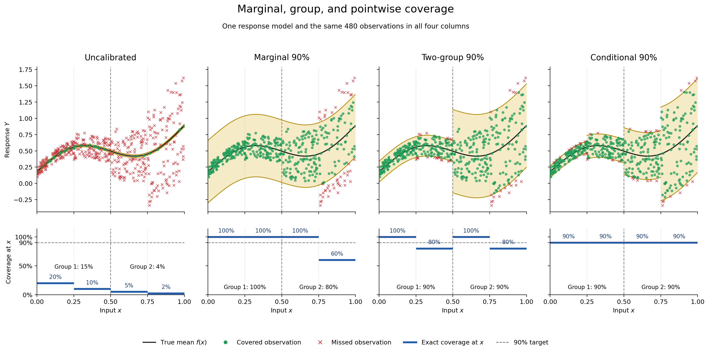
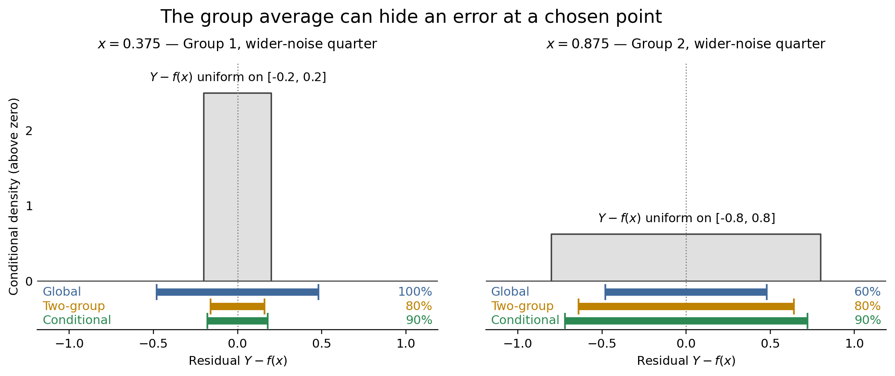

# A concrete version of marginal, group, and conditional coverage

This is an original mathematical illustration inspired by Figure 10 of
[Angelopoulos and Bates](https://arxiv.org/pdf/2107.07511). It uses a continuous
input and explicitly known conditional response law; its coverage percentages
are exact population values, not claims inferred from a finite scatterplot.

Let `X` be uniform on `[0,1]` and let `Z` be independent uniform on `[-1,1]`.
The response is `Y=f(X)+sigma(X) Z`, where

```text
f(x) = 0.18 + 0.55x + 0.23 sin(2 pi x) + 0.16 x^2,

sigma(x) = 0.1 on [0,0.25),  0.2 on [0.25,0.5),
           0.4 on [0.5,0.75), 0.8 on [0.75,1].
```

The two coarse groups are `G1=[0,0.5)` and `G2=[0.5,1]`. For any symmetric
interval `C(x)=[f(x)-w(x),f(x)+w(x)]`, its exact coverage at `x` is
`min(1,w(x)/sigma(x))`. Each quarter has probability 1/4, so the overall
coverage is the average of the four quarter-specific coverages.

| Rule | Halfwidths on the four quarters | Coverage at each quarter | Group 1 / Group 2 | Overall |
| --- | --- | --- | --- | ---: |
| Narrow, uncalibrated | 0.02 everywhere | 20%, 10%, 5%, 2.5% | 15% / 3.75% | 9.375% |
| Marginal 90% | 0.48 everywhere | 100%, 100%, 100%, 60% | 100% / 80% | 90% |
| Two-group 90% | 0.16 on G1; 0.64 on G2 | 100%, 80%, 100%, 80% | 90% / 90% | 90% |
| Conditional 90% | `0.9 sigma(x)` | 90%, 90%, 90%, 90% | 90% / 90% | 90% |

The marginal halfwidth 0.48 gives the advertised 90% overall because
`(1+1+1+0.6)/4=0.9`. All its misses lie in the fourth quarter. The grouped
halfwidths make both group averages 90%, but each group still contains a
quarter with only 80% coverage. At a point selected in one of those quarters,
the group guarantee is not a 90% pointwise guarantee. The second figure shows
this directly at `x=0.375` and `x=0.875`.

Splitting the two groups again, into the four quarters, would give 90% coverage
at every point in this special example because `sigma` is constant on each
quarter. Each additional split also leaves fewer observations to estimate a
correction. For a smoothly changing or more complicated noise scale, no fixed
finite partition would make group coverage equal pointwise coverage exactly.

The two-group rule illustrates **restricted conditional coverage over a fixed
partition**. It does not reproduce the original adaptive RCC algorithm, whose
groups arise from optimization geometry and whose calibration quantiles are
estimated from data. The conditional rule uses the true `sigma(x)` and is an
oracle. This example isolates what each coverage statement means; it does not
establish that RCC improves an optimization problem.





Regenerate both PNG and SVG versions using a Python environment with NumPy and
Matplotlib:

```bash
python experiments/coverage_picture/make_figures.py
```

The script asserts all exact coverage values before drawing and uses one fixed
sample of 480 observations across methods. The scatterplot is illustrative;
the plotted coverage curves come from the analytic conditional law.
