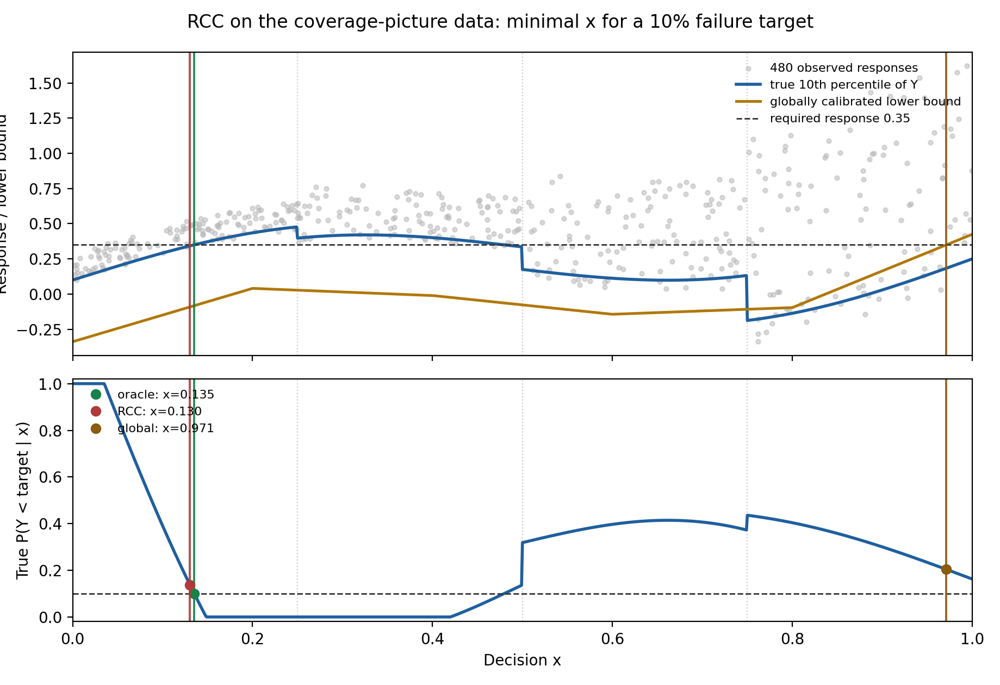
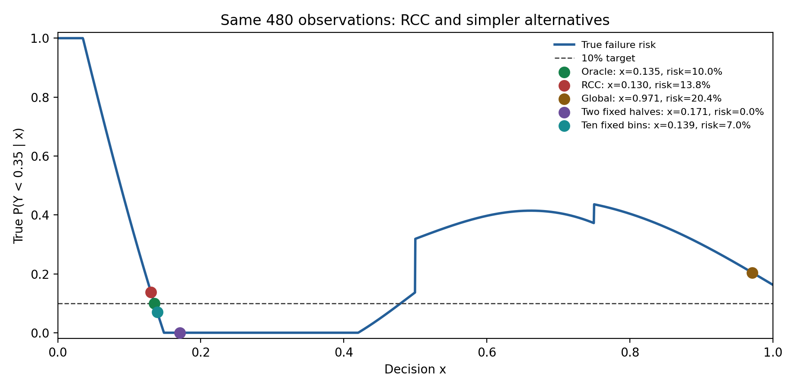

# A concrete version of marginal, group, and conditional coverage

This is an original mathematical illustration inspired by Figure 10 of
[Angelopoulos and Bates](https://arxiv.org/pdf/2107.07511). It uses a continuous
input and explicitly known conditional response law; its coverage percentages
are exact population values, not claims inferred from a finite scatterplot.

Let `X` be uniform on `[0,1]` and let `Z` be independent uniform on `[-1,1]`.
The response is `Y=f(X)+sigma(X) Z`, where

```text
f(x) = 0.18 + 0.55x + 0.23 sin(2 pi x) + 0.16 x^2,

sigma(x) = 0.1 on [0,0.25),  0.2 on [0.25,0.5),
           0.4 on [0.5,0.75), 0.8 on [0.75,1].
```

The two coarse groups are `G1=[0,0.5)` and `G2=[0.5,1]`. For any symmetric
interval `C(x)=[f(x)-w(x),f(x)+w(x)]`, its exact coverage at `x` is
`min(1,w(x)/sigma(x))`. Each quarter has probability 1/4, so the overall
coverage is the average of the four quarter-specific coverages.

| Rule | Halfwidths on the four quarters | Coverage at each quarter | Group 1 / Group 2 | Overall |
| --- | --- | --- | --- | ---: |
| Narrow, uncalibrated | 0.02 everywhere | 20%, 10%, 5%, 2.5% | 15% / 3.75% | 9.375% |
| Marginal 90% | 0.48 everywhere | 100%, 100%, 100%, 60% | 100% / 80% | 90% |
| Two-group 90% | 0.16 on G1; 0.64 on G2 | 100%, 80%, 100%, 80% | 90% / 90% | 90% |
| Conditional 90% | `0.9 sigma(x)` | 90%, 90%, 90%, 90% | 90% / 90% | 90% |

The marginal halfwidth 0.48 gives the advertised 90% overall because
`(1+1+1+0.6)/4=0.9`. All its misses lie in the fourth quarter. The grouped
halfwidths make both group averages 90%, but each group still contains a
quarter with only 80% coverage. At a point selected in one of those quarters,
the group guarantee is not a 90% pointwise guarantee. The second figure shows
this directly at `x=0.375` and `x=0.875`.

Splitting the two groups again, into the four quarters, would give 90% coverage
at every point in this special example because `sigma` is constant on each
quarter. Each additional split also leaves fewer observations to estimate a
correction. For a smoothly changing or more complicated noise scale, no fixed
finite partition would make group coverage equal pointwise coverage exactly.

The two-group rule illustrates **restricted conditional coverage over a fixed
partition**. It does not reproduce the original adaptive RCC algorithm, whose
groups arise from optimization geometry and whose calibration quantiles are
estimated from data. The conditional rule uses the true `sigma(x)` and is an
oracle. This example isolates what each coverage statement means; it does not
establish that RCC improves an optimization problem.


Regenerate both PNG and SVG versions using a Python environment with NumPy and
Matplotlib:

```bash
python experiments/coverage_picture/make_figures.py
```

The script asserts all exact coverage values before drawing and uses one fixed
sample of 480 observations across methods. The scatterplot is illustrative;
the plotted coverage curves come from the analytic conditional law.

## Running the actual RCC logic on these observations

The companion experiment makes this a small optimization problem: choose the
least `x` such that `P(Y < 0.35 | x) <= 0.1`. The algorithm does **not** see the
true `f` or `sigma`: it fits a continuous piecewise-linear mean from the first
240 plotted observations and uses the other 240 for calibration. Its fixed
fitting knots are `0, 0.2, ..., 1`, not the noise boundaries. It then runs the
Chapter 4 adaptive RCC queue, with absolute-residual scores and the original
`delta=0.1` group test, through the exact one-dimensional specialization in
`solve_learned_rcc`. For comparison, global conformalization uses the same
fitted model and calibration observations. The oracle uses the known response
law only for evaluation.

| Method | Chosen `x` | Exact `P(Y < 0.35 | x)` |
| --- | ---: | ---: |
| Population oracle | 0.1352 | 10.0% |
| Global conformal | 0.9713 | 20.4% |
| Adaptive RCC | 0.1303 | 13.8% |

RCC makes 33 geometric splits and selects the unresolved interval
`[0.09775, 0.13033]`, which contains only 10 calibration observations. Its
correction there is inherited from an ancestor, not freshly estimated in that
cell. This run therefore illustrates both its potential reduction in decision
cost relative to global calibration and its failure to meet the desired
conditional risk at the chosen point. Global conformal coverage also does not
give a chance-constraint guarantee after optimization. Neither outcome should
be read as evidence that RCC discovered the four noise regimes.



Regenerate with the project installed and Matplotlib available:

```bash
python experiments/coverage_picture/run_rcc.py
```

## Simpler comparators on the same optimization problem

`compare_baselines.py` keeps the same fitted mean, 240/240 train/calibration
split, absolute-residual score, and finite-sample quantile convention. In
addition to RCC and global calibration, it calibrates separately within two
predeclared halves or ten predeclared equal-width bins; neither partition is
fit from outcomes or optimization geometry. It solves the resulting 1-D
piecewise constraint on a grid of spacing `0.0001` (RCC and global still use
their exact piecewise-affine solves). The first sample gives:

| Method | Chosen `x` | Exact conditional failure risk |
| --- | ---: | ---: |
| Oracle | 0.135 | 10.0% |
| RCC | 0.130 | 13.8% |
| Ten fixed bins | 0.139 | 7.1% |
| Two fixed halves | 0.171 | 0.0% |
| Global conformal | 0.971 | 20.4% |

Across 100 prespecified seeds, `20261026` through `20261125`, the results are:

| Method | Solutions | Mean chosen `x` (when returned) | Mean true risk (when returned) | Returned points at or below 10% risk |
| --- | ---: | ---: | ---: | ---: |
| RCC | 100/100 | 0.1446 | 4.1% | 90/100 |
| Ten fixed bins | 100/100 | 0.1477 | 2.4% | 99/100 |
| Two fixed halves | 100/100 | 0.1843 | 0.0% | 100/100 |
| Global conformal | 53/100 | 0.9541 | 22.8% | 0/53 |

The ten-bin comparison is especially informative: simple *predeclared*
localization nearly matches RCC's decision cost and is safer in these draws.
The selected decisions usually lie inside the first noise quarter, where
several ten-bin cells happen to have approximately homogeneous residuals. This
is an advantage of this deliberately simple response law, not evidence that
fixed bins will work in higher dimensions. Moreover, calibrating cells and
then choosing the cheapest among them does **not** give pointwise validity at
the selected decision, even when the partition was fixed in advance. The table
reports exact risks using the known simulation law, not formal guarantees.



```bash
python experiments/coverage_picture/compare_baselines.py
```

A direct conditional-quantile model would instead estimate the lower tenth
percentile of `Y`, then choose the least `x` at which that estimate (with any
desired global calibration correction) exceeds `0.35`. Here the true lower
tenth percentile is `f(x)-0.8 sigma(x)`, giving the oracle decision `0.1352`.
Unlike the fixed-bin comparisons, fitting such a model well from only 240
training observations—especially near the abrupt scale changes—is a separate
statistical task, not something established by this experiment.
